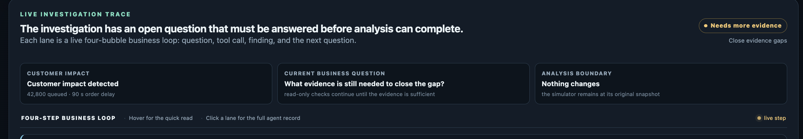
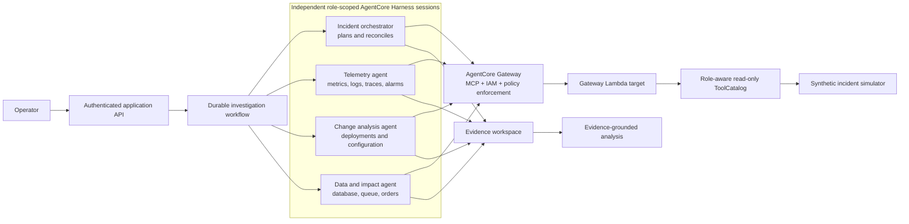
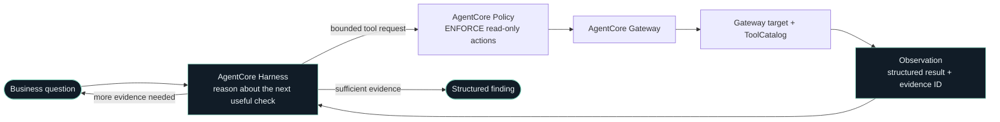
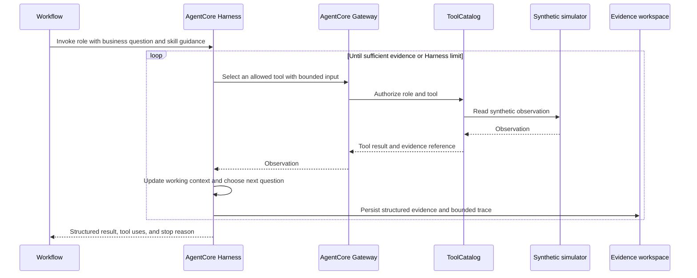
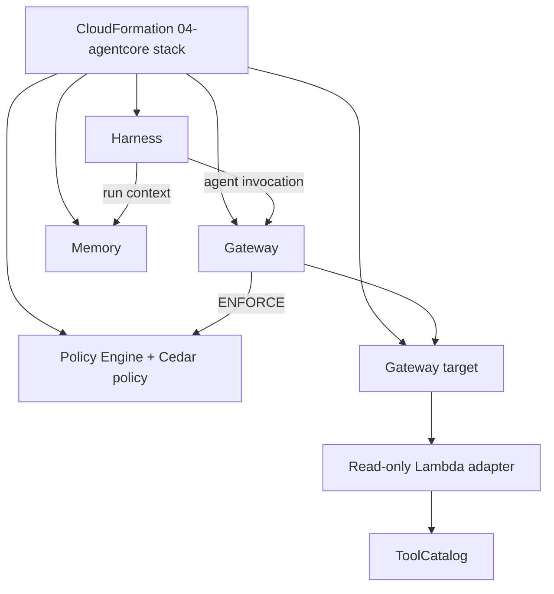
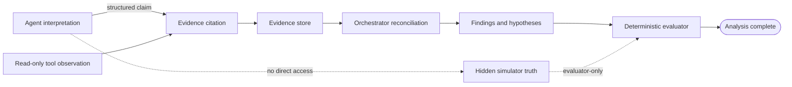

# OpsFusion

OpsFusion is a synthetic cloud-incident investigation console built with
Amazon Bedrock AgentCore. It demonstrates a controlled multi-agent workflow:
several role-scoped agents investigate the same incident, call bounded
read-only tools, save evidence, and reconcile their observations into an
analysis that can be reviewed and evaluated.

The scenarios, telemetry, deployments, orders, customers, and runbooks are
synthetic. The current product boundary is intentionally read-only. A run
gathers evidence, closes evidence gaps, evaluates the unchanged snapshot, and
stops at **Analysis complete**. Approval, remediation, recovery, and other
state-changing actions are not runtime capabilities.

## What the demo shows

- **Four cooperating agents** investigate one incident from different business
  perspectives.
- **AgentCore Harness** provides the managed model/tool loop for each role.
- **AgentCore Gateway** is the single tool boundary between agents and the
  synthetic simulator.
- **Evidence records** preserve the observation, source, query, role, and run
  that produced each finding.
- **Deterministic evaluation** checks evidence quality, citations, causal
  coverage, and the read-only boundary.
- **The operator sees the work**: agent role, configured skill, tool calls,
  bounded inputs, observations, evidence IDs, and structured findings.

## Web walkthrough

The web console is an operator-facing view of the read-only investigation. It
starts with authenticated access, lets an operator choose a synthetic
scenario, shows the live agent investigation as it gathers evidence, and
finishes with an independent analysis evaluation.

### 1. Sign in as an operator

The console uses invite-only Cognito authentication. The sign-in screen makes
the operating boundary explicit: this is a protected operator surface for the
synthetic OpsFusion environment.


### 2. Choose the incident and investigation objective

The operator selects a synthetic incident and starts the investigation. The
scenario brief summarizes the customer-facing symptoms before any agent work
begins, while the objective defines the business question the agents must
answer.


### 3. Follow the live investigation loop

The live trace shows the current business question, the customer impact being
measured, and the analysis boundary. Each agent can repeat its own question →
tool call → finding → next-question loop until the evidence is sufficient.
Nothing changes in the simulator during this phase.



### 4. Review the analysis evaluation

The evaluation view reports whether the analysis is evidence-grounded and
still read-only. It checks evidence citations, hidden-state separation, root
cause coverage, and the absence of state changes before the run is considered
complete.


The standalone screenshot index is available in [`picts.md`](picts.md).

## Multi-agent architecture

Each role receives its own AgentCore Harness invocation and session. The
durable workflow starts the specialist investigations in parallel, persists
their evidence, and then asks the orchestrator to reconcile the results. If a
gap remains, the workflow can schedule another bounded read-only investigation.



The important boundary is the Gateway. Agents do not receive direct access to
the simulator, databases, queues, or runbooks. They can request only tools
exposed through the Gateway, and each request is checked again by the local
tool catalog before the synthetic observation is returned.

## Agents, skills, and responsibilities

The application configures the roles in [`agents/roles.py`](agents/roles.py).
Skills are role-specific reference guidance placed in the Harness system
prompt. They help an agent decide what to investigate, but they are not an
authorization mechanism and cannot authorize a state change.

| Agent                          | Skill used in the run                               | Business responsibility                                                                                            | Read-only tools                                                                                                          |
| ------------------------------ | --------------------------------------------------- | ------------------------------------------------------------------------------------------------------------------ | ------------------------------------------------------------------------------------------------------------------------ |
| Incident orchestrator          | `investigation-planning`, `evidence-reconciliation` | Break the incident into bounded questions, collect shared evidence, reconcile facts, relationships, and hypotheses | Incident context, shared evidence, runbook search                                                                        |
| Telemetry investigation agent  | `telemetry-triage`                                  | Establish timing and severity from service health, metrics, logs, traces, and alarms                               | Incident context, CloudWatch metrics, application logs, service traces, alarms, metric-window comparison, service health |
| Change analysis agent          | `change-analysis`                                   | Compare deployments and configuration changes with incident timing and affected behavior                           | Incident context, recent deployments, deployment details, version comparison, configuration changes, runbook search      |
| Data and business impact agent | `business-impact-analysis`                          | Quantify database pressure, queue backlog, order delay, and customer impact                                        | Incident context, database metrics, queue metrics, order records, order history, customer-impact calculation             |

The role configuration is visible in the application source, and each Harness
trace records the role, configured skills, prompt metadata, tool uses, usage,
and bounded errors. Raw model responses are not persisted as a substitute for
structured findings or private reasoning.

## The AgentCore agentic loop

This is an actual Harness-managed agent loop, not a local `for` loop that
pretends to be an agent. OpsFusion supplies the business question, role
instructions, allowed Gateway binding, and safety limits. AgentCore Harness
owns model reasoning, tool selection, iteration, streamed events, and the
stopping decision. The application normalizes the stream and persists the
result at the workflow boundary.



In the deployed configuration, each invocation is bounded by 16 Harness
iterations, 4,096 output tokens, and a 180-second timeout. Those limits bound
the loop; they do not turn it into a fixed sequence of predetermined tool
calls.

The business view of one loop is:

1. **Question** — what decision-relevant fact is still missing?
2. **Tool call** — which authorized read-only observation can answer it?
3. **Finding** — what did the tool actually return, and which evidence ID
   supports it?
4. **Next question** — is another check needed, or is the role finished?



## Tools exposed through AgentCore Gateway

The Gateway target exposes 18 tools. Every tool is marked read-only and is
also checked against the calling role by `gateway/tool_catalog.py`.

| Category            | Tools                                                                                                                                            | Purpose                                                                     |
| ------------------- | ------------------------------------------------------------------------------------------------------------------------------------------------ | --------------------------------------------------------------------------- |
| Workflow context    | `get_incident_context`, `get_shared_evidence`                                                                                                    | Anchor the agent to the current synthetic run and shared evidence workspace |
| Observability       | `query_cloudwatch_metrics`, `search_application_logs`, `get_service_traces`, `get_active_alarms`, `compare_metric_windows`, `get_service_health` | Measure symptoms, timing, correlations, and resource pressure               |
| Change analysis     | `list_recent_deployments`, `get_deployment_details`, `compare_deployment_versions`, `get_configuration_changes`                                  | Inspect observable changes without applying anything                        |
| Reference knowledge | `search_runbooks`                                                                                                                                | Retrieve synthetic troubleshooting guidance as untrusted reference content  |
| Business impact     | `get_database_metrics`, `get_queue_metrics`, `query_order_records`, `get_order_processing_history`, `calculate_customer_impact`                  | Quantify operational backlog and customer-visible consequences              |

Tool calls carry the run, tenant, actor, role, and request context. The
Gateway policy permits only the registered read-only action set for this
Gateway, while the ToolCatalog applies the role-level check before dispatching
to the simulator. There are no deployment, restart, scale, approval, recovery,
or simulator-mutation tools in this catalog.

## How Amazon Bedrock AgentCore is used

The `04-agentcore` CloudFormation stack is the authoritative provisioning path
for the AgentCore resources. The application does not create a second set of
runtime resources at startup.

| AgentCore capability         | How OpsFusion uses it                                                                                                                                                                                 |
| ---------------------------- | ----------------------------------------------------------------------------------------------------------------------------------------------------------------------------------------------------- |
| **Harness**                  | Runs the model/tool loop for each role. The role system prompt, model configuration, Gateway binding, skill guidance, iteration limit, token limit, timeout, and actor ID are supplied at invocation. |
| **Gateway**                  | Publishes the synthetic simulator as an MCP tool boundary with AWS IAM authorization. Harness calls the Gateway rather than calling Lambda or simulator code directly.                                |
| **Gateway target**           | Routes the Gateway tool calls to the read-only Lambda adapter, which invokes the typed `ToolCatalog`.                                                                                                 |
| **Policy Engine and Policy** | Enforces the allowed Gateway actions with Cedar in `ENFORCE` mode. The policy is scoped to the OpsFusion Gateway resource and contains only the 18 read-only actions.                                 |
| **Memory**                   | Provides the Harness memory resource for run context using a summary-oriented strategy. It is a context aid, not an authority source.                                                                 |
| **Registry**                 | Holds capability metadata and role records for discovery and governance. Registry submission or approval is separate from runtime tool authorization.                                                 |

The thin adapter in [`agents/harness.py`](agents/harness.py) calls the managed
`InvokeHarness` API and normalizes its event stream. It does not implement
model reasoning, tool selection, or a replacement agent loop.



## Evidence, authority, and stopping point

The model may interpret observations, but it cannot promote an observation to
authority by itself. The workflow and evaluator preserve the boundary between
what a tool returned, what an agent inferred, and what the simulator knows as
hidden scenario truth.



The UI is therefore an investigation workspace, not a change-management
approval console. The normal run ends with:

- evidence collected by the role that called the tool;
- the exact tool name and bounded input available for inspection;
- structured findings, hypotheses, unresolved questions, and evidence IDs;
- a read-only analysis result suitable for review and evaluation.

## Repository map

| Directory                        | Responsibility                                                              |
| -------------------------------- | --------------------------------------------------------------------------- |
| `agents/`                        | Role definitions, skills, Harness adapter, sessions, and structured outputs |
| `gateway/`                       | Tool catalog, Gateway Lambda adapter, and tool schemas                      |
| `simulator/`                     | Synthetic incident state, fixtures, observations, and persistence           |
| `evidence/`                      | Evidence records and provenance validation                                  |
| `workflow/`                      | Local and durable orchestration, checkpoints, follow-ups, and completion    |
| `contracts/`                     | Shared request, response, task, evidence, and evaluation models             |
| `evaluation/`                    | Deterministic evidence, citation, causality, and safety checks              |
| `memory/`                        | AgentCore Memory adapter and context handling                               |
| `registry/`                      | Capability discovery and governance records                                 |
| `knowledge/`                     | Synthetic runbooks and retrieval                                            |
| `apps/api/`                      | Authenticated operator API                                                  |
| `apps/web/`                      | Business-focused investigation console                                      |
| `infrastructure/cloudformation/` | Manifest-driven AWS stacks and deployment orchestration                     |

- [`TUTORIAL.md`](TUTORIAL.md) — concepts and the Harness loop walkthrough.
- [`docs/ARCHITECTURE.md`](docs/ARCHITECTURE.md) — authority boundaries and
  runtime relationships.
- [`docs/FIVE_MINUTE_WALKTHROUGH.md`](docs/FIVE_MINUTE_WALKTHROUGH.md) — the
  operator flow through the console.
- [`docs/DEPLOYMENT.md`](docs/DEPLOYMENT.md) — deployment and access details.
- [`CASE_STUDY.md`](CASE_STUDY.md) — the business scenario and requirements.

## AWS deployment

### Prerequisites

- Python 3.12 or later
- AWS CLI credentials for the target account
- AWS SAM CLI
- Node.js and npm
- An AWS region and profile selected by the operator

The deployment runner validates templates, runs tests, builds the web console,
deploys dependent CloudFormation/SAM stacks, persists stack outputs, and
publishes synthetic runbooks and the versioned web artifact.

Use your own profile and region. Do not commit credentials or generated,
environment-specific outputs:

```bash
export AWS_PROFILE=your-aws-profile
export AWS_REGION=us-east-1

./deploy-all.sh \
  --environment dev \
  --release-id YYYYMMDD-opsfusion \
  --profile "$AWS_PROFILE" \
  --resolve-s3
```

Run a non-mutating deployment plan first:

```bash
./deploy-all.sh \
  --environment dev \
  --plan \
  --profile "$AWS_PROFILE"
```

The manifest deploys these stacks in dependency order:

1. `00-foundation` — shared roles and deployment foundations.
2. `01-state` — DynamoDB workflow, evidence, and simulator state.
3. `02-simulator` — synthetic incident runtime and Gateway target Lambda.
4. `03-knowledge` — runbook storage and retrieval resources.
5. `04-agentcore` — CloudFormation-managed Harness, Gateway, Memory, and
   read-only Policy resources.
6. `05-workflow` — durable workflow worker and Step Functions state machine.
7. `06-application` — authenticated API, Cognito, and application Lambda.
8. `07-web` — web artifact storage and publication resources.
9. `08-observability-evaluation` — observability and evaluation resources.

The deployment context is written to
`infrastructure/cloudformation/build/deployment-context-<environment>.json`.
Treat it as generated environment-specific output and do not commit it.
CloudFormation outputs provide the console URL and Cognito identifiers after a
successful deployment; the README intentionally does not publish those values.

### AgentCore and Registry boundaries

The `04-agentcore` stack is the single provisioning path for the AgentCore
Gateway, Gateway target, Harness, Memory, and read-only Policy Engine. A
normal deployment does not require a second SDK provisioning command or a
manual environment-variable handoff.

On a fresh environment, the deployment orchestrator may perform two
CloudFormation passes: the first creates the policy engine and Gateway, and
the second attaches the resulting policy-engine identifier to the Gateway.
This is an implementation detail of the CloudFormation dependency and does not
create an out-of-band AgentCore resource.

Registry records remain a separate governance concern because submission and
approval are human decisions. Reconcile them only when that catalog workflow
is intended:

```bash
./deploy-all.sh \
  --environment dev \
  --profile "$AWS_PROFILE" \
  --reconcile-registry
```

Use explicit registry submission or approval options only for the corresponding
governance decision. They do not grant runtime tool permission.

### Cognito access

The application stack creates an invite-only Cognito User Pool. The Function
URL serves the login shell and health endpoint, while protected API routes
validate Cognito ID tokens. Administrative user management requires membership
in the `opsfusion-admin` group.

After deployment, obtain `CognitoUserPoolId` from the `06-application`
CloudFormation stack and bootstrap an administrator with an authorized AWS
identity:

```bash
POOL_ID=<cognito-user-pool-id-from-stack-output>
ADMIN_EMAIL=admin@example.com

aws cognito-idp admin-create-user \
  --user-pool-id "$POOL_ID" \
  --username "$ADMIN_EMAIL" \
  --user-attributes Name=email,Value="$ADMIN_EMAIL" \
  --desired-delivery-mediums EMAIL \
  --profile "$AWS_PROFILE" \
  --region "$AWS_REGION"

aws cognito-idp admin-add-user-to-group \
  --user-pool-id "$POOL_ID" \
  --username "$ADMIN_EMAIL" \
  --group-name opsfusion-admin \
  --profile "$AWS_PROFILE" \
  --region "$AWS_REGION"
```

The invited administrator completes the first-login password challenge and can
then invite additional operators through the admin-only user-management
surface. The API enforces the group boundary; hiding a browser control is not
the security boundary.

## Safety and data boundary

- All scenarios, telemetry, deployments, orders, and customers are synthetic.
- Hidden root-cause data is available only to the simulator and evaluator.
- Agent-facing tools return observations and evidence references, never hidden
  ground truth or conclusions.
- Gateway tools are read-only and role-scoped.
- The runtime stops after analysis and does not expose approval, remediation,
  recovery-tick, or state-changing routes.
- Do not commit credentials, tokens, generated deployment contexts, or
  environment-specific CloudFormation outputs.

## License and project status

This repository is a proof of concept for learning and evaluation. It is not a
production incident-management system and should not be connected to live
customer or infrastructure data without a separate security and operations
review.
