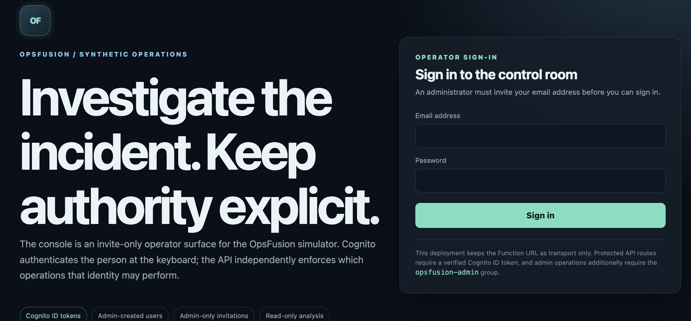
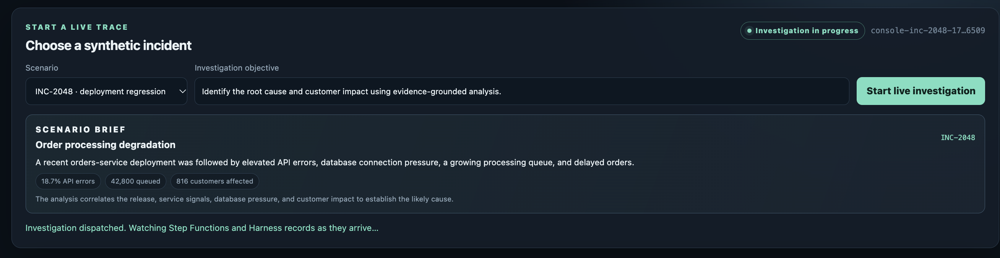
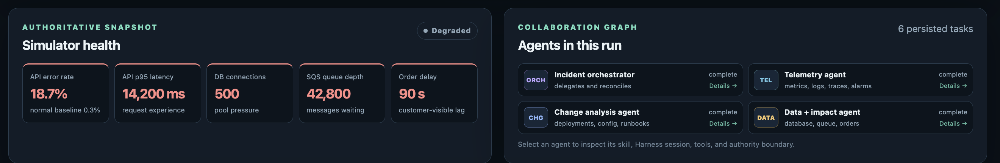
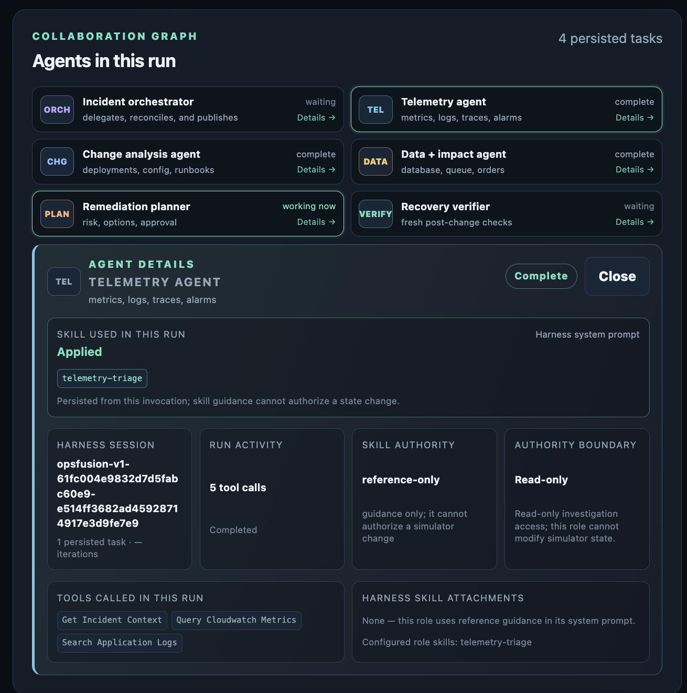
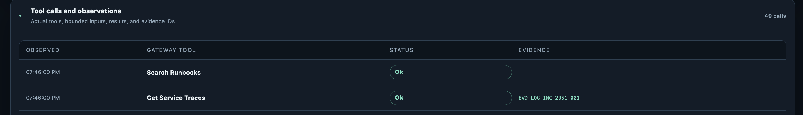
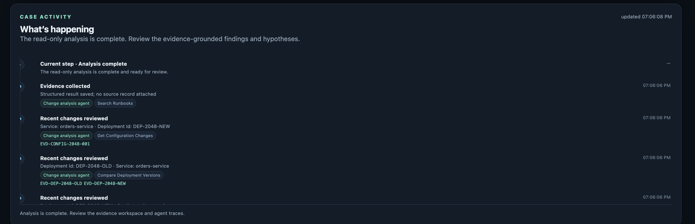
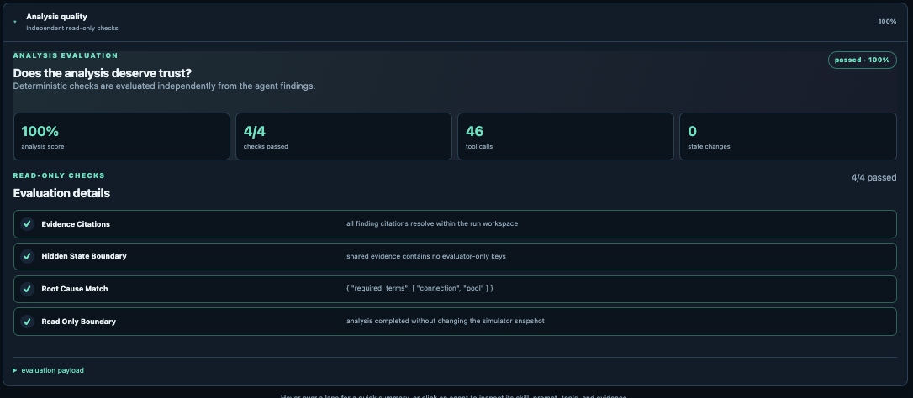

# OpsFusion

OpsFusion is a synthetic cloud-incident investigation console built with
Amazon Bedrock AgentCore. It shows four role-scoped agents investigating one
incident through bounded read-only tools, preserving evidence, and producing a
reviewable analysis.

All scenarios, telemetry, deployments, orders, customers, and runbooks are
synthetic. The runtime stops at **Analysis complete**. It does not approve,
remediate, recover, or otherwise change simulator state.

## Overview

The operator chooses a scenario and an investigation objective. The durable
workflow runs the telemetry, change-analysis, and data-impact investigations,
then asks the incident orchestrator to reconcile the evidence. Each role runs
through an Amazon Bedrock AgentCore Harness invocation and reaches operational
data only through the read-only AgentCore Gateway.

The console makes the investigation visible: agent roles, configured skills,
tool calls, bounded inputs, observations, evidence IDs, findings, and the
independent evaluation are all available for review.

## Features

- Four cooperating agents with role-specific skills and least-privilege tool
  scopes.
- A genuine AgentCore Harness-managed model/tool loop for each role.
- An AgentCore Gateway target backed by a synthetic, role-aware ToolCatalog.
- Run-scoped evidence records with provenance and citation validation.
- Durable workflow checkpoints and bounded read-only follow-up investigations.
- Independent checks for evidence citations, causal coverage, hidden-state
  isolation, and unchanged simulator state.
- Cognito-authenticated operator access and an invite-only admin boundary.

## Deployment

See [`docs/DEPLOYMENT.md`](docs/DEPLOYMENT.md) for prerequisites, preflight
checks, CloudFormation stack order, targeted retries, AgentCore provisioning,
Registry governance, and Cognito bootstrap.

The normal entry point is:

```bash
export AWS_PROFILE=your-aws-profile
export AWS_REGION=us-east-1

./deploy-all.sh \
  --environment dev \
  --release-id YYYYMMDD-opsfusion \
  --profile "$AWS_PROFILE" \
  --region "$AWS_REGION" \
  --resolve-s3
```

Use `--plan` for a non-mutating preflight. Do not commit credentials,
generated deployment context, or environment-specific CloudFormation outputs.

## Screenshots and walkthrough

The screenshots show the operator path from authentication to evidence-backed
analysis. For a written five-minute demonstration, see
[`docs/FIVE_MINUTE_WALKTHROUGH.md`](docs/FIVE_MINUTE_WALKTHROUGH.md).

### 1. Sign in

The console is an invite-only operator surface for the synthetic environment.



### 2. Choose a scenario

Select the incident and review its business symptoms and investigation
objective before starting.



### 3. See the incident and participating agents

The overview connects service symptoms with the collaborating agent roles.



### 4. Inspect an agent's skill and tools

Selecting an agent reveals its configured skill, Harness session, authority
boundary, and tools called in the run.



### 5. Follow the live investigation loop

The live trace shows the business question, tool call, finding, and next
question while the simulator remains unchanged.


### 6. Inspect tool calls and evidence

The tool-call view connects an agent's question to the Gateway tool, status,
observation, and evidence ID.



### 7. Read the completed analysis

The case activity view shows the structured result and cited evidence when the
read-only investigation is complete.



### 8. Review the evaluation

The independent checks confirm evidence citations, causal coverage,
hidden-state separation, and zero state changes.



## AgentCore services

| Service or feature | How OpsFusion uses it                                                                                             |
| ------------------ | ----------------------------------------------------------------------------------------------------------------- |
| AgentCore Harness  | Runs the model reasoning, tool selection, iteration, streaming, and stopping loop for each role.                  |
| AgentCore Gateway  | Exposes the synthetic operational tools through an MCP boundary with IAM authorization.                           |
| Gateway target     | Routes tool requests to the read-only Lambda adapter and typed ToolCatalog.                                       |
| AgentCore Policy   | Enforces the Gateway's 18 read-only actions in `ENFORCE` mode with a Gateway-scoped Cedar policy.                 |
| AgentCore Memory   | Provides summary-oriented Harness context; it is not an authority source.                                         |
| Registry           | Catalogs capabilities and role records for discovery and governance; it is separate from runtime authorization.   |
| AgentCore Runtime  | Not provisioned as a separate application runtime; the managed Harness service owns the agent execution boundary. |

## Documentation

- [`TUTORIAL.md`](TUTORIAL.md) — detailed multi-agent architecture, Harness
  loop, Gateway tools, skills, memory, evidence, policy, and implementation
  walkthrough, with Mermaid diagrams.
- [`docs/ARCHITECTURE.md`](docs/ARCHITECTURE.md) — concise authority and
  runtime boundaries.
- [`docs/DEPLOYMENT.md`](docs/DEPLOYMENT.md) — AWS deployment and access
  operations.
- [`docs/FIVE_MINUTE_WALKTHROUGH.md`](docs/FIVE_MINUTE_WALKTHROUGH.md) —
  operator demonstration script.
- [`CASE_STUDY.md`](CASE_STUDY.md) — business scenario and requirements.
- [`PLAN.md`](PLAN.md) — implementation plan and design context.
