# Using Amazon Bedrock AgentCore in OpsFusion

OpsFusion is a synthetic cloud incident investigation environment. It models
the operational data that a SaaS platform might expose—metrics, logs,
deployments, database observations, queues, orders, and runbooks—without
connecting to production systems.

The demonstration uses a team of role-scoped agents to investigate an
incident, combine evidence, and stop at an evidence-grounded analysis. The
agents run through Amazon Bedrock AgentCore Harness and retrieve observations
through AgentCore Gateway. The console does not plan, approve, execute, or
perform state-changing actions.

The application and simulator remain responsible for authoritative state,
evidence provenance, durable checkpoints, and evaluation. The model is allowed
to reason about observations, but it is not allowed to declare a state change
authoritative or bypass the read-only application boundary.

This tutorial explains how the concepts in the case study map to the
implementation. It is intended to be read alongside
[`CASE_STUDY.md`](CASE_STUDY.md), [`PLAN.md`](PLAN.md), and the source files
linked below.

## 1. The central idea: simulate the environment, not the intelligence

The simulator supplies realistic observations. It does not supply the answer.

For `INC-2048`, a tool can return observations such as:

- API error rate is `18.7%`.
- Database connections are at `500`.
- Logs contain connection timeout and retry records.
- Deployment `orders-service-v2.7.0` changed the connection-pool setting from
  `100` to `500`.
- `1,240` orders are delayed.

Those observations are evidence, not a root-cause label. The model must connect
them into a relationship or hypothesis and cite the evidence IDs. The hidden
scenario definition is available to the simulator and evaluator, but not to
the agent-facing tool response.

The boundary is implemented in three places:

| Concept | Implementation |
| --- | --- |
| Hidden scenario truth | `simulator/fixtures.py` and `ScenarioEngine.hidden_truth()` |
| Agent-visible observations | `ScenarioEngine.observe()` and `gateway/tool_catalog.py` |
| Evaluator-only comparison | `evaluation/deterministic.py` |

The result is a useful separation:

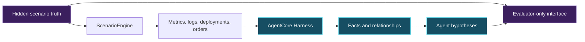

## 2. How an OpsFusion investigation works

An operator starts a run for a scenario and gives the system an objective such
as:

> Investigate `INC-2048`, identify the likely root cause, and determine
> customer impact from the available evidence.

The workflow has two different orchestration layers:

1. **AgentCore Harness** owns the inner agent loop for each role: model
   reasoning, tool selection, tool-result processing, additional turns, and
   stopping.
2. **OpsFusion workflow code** owns the outer investigation lifecycle:
   parallel specialist sessions, evidence persistence, follow-up boundaries,
   reconciliation, and the final analysis checkpoint.

The current POC has two entry points into the same durable lifecycle:

- The operator API calls `DurableInvestigationWorkflow` directly so the console
  can run an interactive investigation and return a result.
- The deployed Step Functions state machine calls `workflow.worker` at durable
  stage boundaries. It persists and resumes the same run checkpoint without
  implementing another model/tool loop.

This distinction is intentional. Harness is the agentic loop; Step Functions
is the durable workflow boundary.

### End-to-end architecture

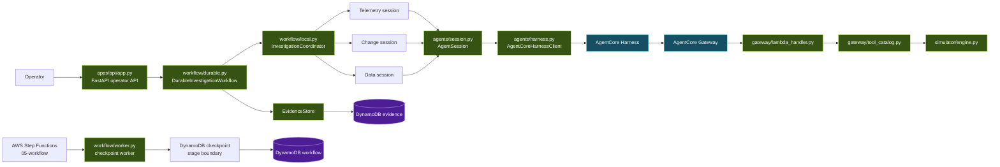

The important direction is the return path: a Gateway tool returns an
observation to Harness, and Harness decides whether another tool call is
needed. The application records the event and evidence metadata, but it does
not select the next model tool call.

## 3. Starting a managed Harness invocation

The invocation boundary is implemented by
[`agents/harness.py`](agents/harness.py) and
[`agents/session.py`](agents/session.py).

An `AgentSession.invoke()` call performs these application-owned steps:

1. Resolve the role and, when configured, resolve its approved Registry record.
2. Create a bound `InvocationContext` containing the run, tenant, actor, role,
   session, request, and trace identifiers.
3. Build a role-specific prompt containing the objective, allowed tools,
   incident context, and evidence contract.
4. Call the managed `InvokeHarness` data-plane API through
   `AgentCoreHarnessClient`.
5. Consume the returned event stream and normalize text, tool calls, usage,
   metrics, stop reason, and errors.
6. Parse the bounded JSON output into findings, hypotheses, questions, and
   recommendations.

The adapter does **not** implement this loop:

```text
while not finished:
    response = model(...)
    tool = choose_tool(response)
    result = call_tool(tool)
    messages.append(result)
```

That loop is the responsibility of AgentCore Harness. The adapter only starts
the managed invocation and consumes its stream.

### The Harness configuration boundary

`AgentCoreHarnessClient._config()` supplies the managed Harness invocation
with:

| Setting | OpsFusion implementation |
| --- | --- |
| Model | `us.amazon.nova-2-lite-v1:0` through the Bedrock model configuration |
| System prompt | `AgentRole.system_prompt()` in `agents/roles.py` |
| Tool source | AgentCore Gateway target `opsfusion-simulator` |
| Tool selector | `@opsfusion-simulator` when Gateway is configured |
| Memory actor | Stable role key, for example `telemetry-agent` |
| Iteration bound | `16` |
| Output bound | `4,096` tokens |
| Invocation timeout | `180` seconds |

Harness can stop earlier when the agent has enough evidence. The application
does not infer completion from a particular number of tool calls.

### Invocation sequence

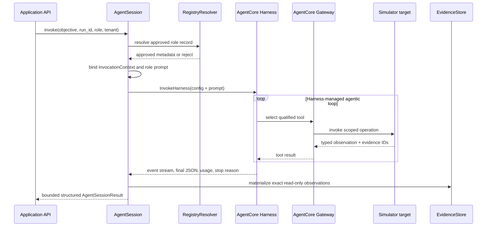

The evidence materialization step is not a second reasoning loop. The managed
Harness stream already contains the tool interaction. OpsFusion replays the
exact read-only request against the deterministic simulator so the local
`EvidenceStore` has authoritative typed `ToolResponse` records behind every
finding citation.

If the model returns malformed JSON, `AgentSession` permits one bounded repair
invocation. That repair is schema correction; it does not grant new tools,
change the role, or execute a state-changing action.

## 4. The multi-agent team and its implementation

OpsFusion uses one orchestrator and three specialists. Each role has a distinct
prompt description, tool allow-list, skill names, and Registry record in
[`agents/roles.py`](agents/roles.py).

| Role | Main question | Allowed tool families | Concrete implementation |
| --- | --- | --- | --- |
| Orchestrator | What is the strongest explanation and what evidence is missing? | Incident context, shared evidence, runbooks | `agents/orchestrator.py` and the orchestrator `AgentSession` |
| Telemetry Agent | What changed in metrics, logs, traces, alarms, and timing? | Observability | `agents/telemetry.py` and `AGENT_ROLES["telemetry-agent"]` |
| Change Agent | What deployments or configuration changes are technically consistent? | Deployments, configuration, runbooks | `agents/change_analysis.py` |
| Data Agent | What happened to databases, queues, orders, and customers? | Database, queue, order, impact tools | `agents/data_impact.py` |

The conceptual orchestrator delegates the investigation. In the POC, the
parallel scheduling decision is deliberately application-owned:
`InvestigationCoordinator.run()` submits the telemetry, change, and data
sessions to a `ThreadPoolExecutor`. This keeps concurrency, checkpointing, and
role boundaries deterministic. The real orchestrator Harness session then
reconciles the shared evidence and can request follow-up investigations.

This gives the system both properties the case study requires:

- independent investigations run concurrently;
- the model still performs genuine evidence reconciliation and asks for more
  evidence when it identifies a material gap.

### Investigation lifecycle

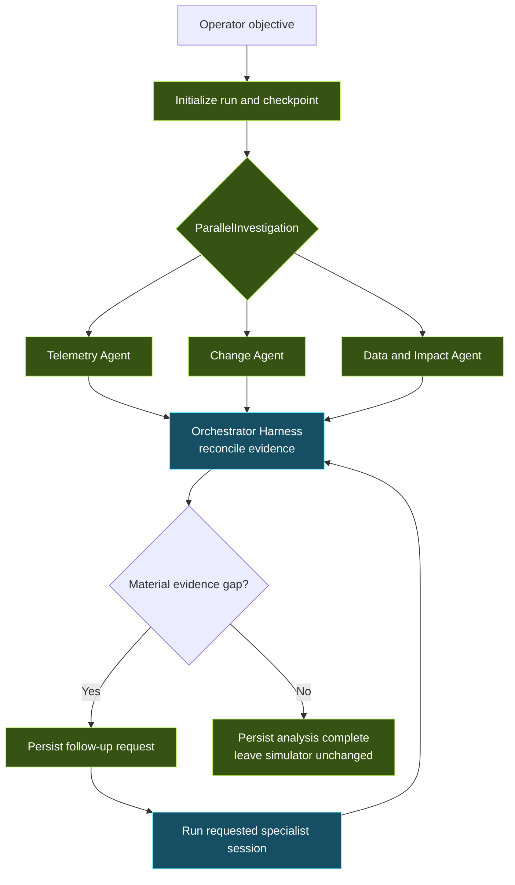

## 5. Connecting Harness to operational tools through Gateway

The tool boundary has three layers:

1. `ToolCatalog` defines typed operations, role authorization, read-only
   metadata, evidence references, and simulator dispatch.
2. `gateway/lambda_handler.py` adapts the AgentCore Gateway Lambda target event
   shape into a `ToolContext`.
3. AgentCore Gateway exposes that Lambda target to Harness as qualified tools.

The catalog contains 18 read-only operations spanning workflow context,
observability, change analysis, and business impact.
The actual Gateway target is configured by the `04-agentcore` CloudFormation
stack and is bound to the simulator Lambda in the deployed environment.

### Role-scoped tools

`ToolCatalog.invoke()` checks the caller role before dispatching the handler.
For example:

- the Telemetry Agent can query metrics and logs;
- the Change Agent can inspect deployments and configuration;
- the Data Agent can inspect database, queue, and order records;
- the Orchestrator can retrieve the shared evidence workspace and reconcile
  specialist results.

There is no remediation, approval, recovery-tick, or state-changing catalog
operation. Every Gateway tool is read-only, and the application stops after
analysis is complete.

### Tool-call sequence

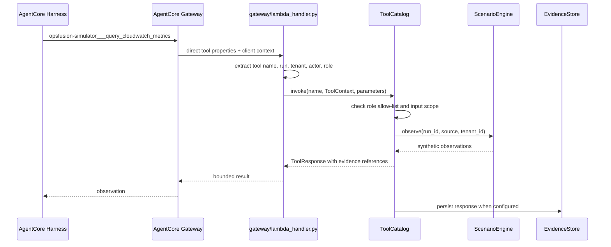

Gateway qualification does not mean unrestricted access. The target still
requires a run ID and role, validates tenant/run scope, and applies the
catalog's authorization check before reading the simulator.

## 6. What “the tool never provides the answer” means

This rule prevents the simulator from secretly scripting the model's
conclusion.

### Allowed tool response

```json
{
  "observations": [
    {"metric": "database_connections", "value": 500},
    {"metric": "max_connections", "value": 500}
  ],
  "evidence_ids": ["EVD-DB-2048-001", "EVD-DB-2048-002"]
}
```

### Not an allowed tool response

```json
{
  "root_cause": "database_connection_pool_regression",
  "conclusion": "The deployment caused the incident",
  "recommended_action": "rollback"
}
```

The model may produce the following finding after correlating multiple tool
responses:

```json
{
  "claim_type": "hypothesis",
  "statement": "The deployment's connection-pool change is the likely cause of database saturation and downstream queue growth.",
  "evidence_ids": ["EVD-CONFIG-2048-001", "EVD-DB-2048-001", "EVD-LOG-DB-208"],
  "confidence": 0.9
}
```

That distinction is implemented by `ToolCatalog` returning observations and
by `InvestigationCoordinator._persist_output()` validating evidence citations
when it stores model findings.

## 7. The shared evidence workspace

Natural-language messages are not enough for incident collaboration. OpsFusion
stores a structured evidence workspace in
[`evidence/store.py`](evidence/store.py).

The workspace separates:

| Record | Meaning |
| --- | --- |
| Evidence reference | A source observation returned by a tool |
| Finding | A fact or relationship stated by an agent and backed by evidence IDs |
| Hypothesis | An interpreted causal explanation supported by finding IDs |
| Unresolved question | A gap that may trigger another specialist task |
| Tool event | Bounded execution metadata and evidence references |

The evidence store validates that every cited record belongs to the current
run and tenant. In the deployed API and Gateway target, findings, evidence,
and tool events are persisted in DynamoDB; local tests use the in-memory
adapter.

### Evidence flow

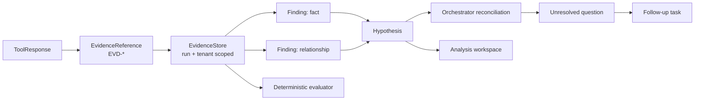

The confidence value on a finding or hypothesis is the agent's stated
assessment. It is not treated as a calibrated probability. The evaluator
checks citation validity, causal coverage, and the read-only boundary independently.

## 8. Registry, skills, memory, knowledge, policy, and identity

These capabilities solve different problems and should not be conflated.

### Agent Registry: capability discovery and governance

`registry/manifest.py` defines records for the orchestrator, three specialist
agents, the Gateway, and reusable skills. `registry/provision.py` reconciles
those records, while `registry/discovery.py` resolves only approved records
that also pass the static role allow-list.

At runtime, `AgentSession.invoke()` resolves the approved record for its own
role. A model-produced record name is never trusted as authority.

Registry status answers:

> Is this agent, tool server, or skill version available for discovery?

It does not grant:

> Permission to change an incident run.

### Skills and runbooks: guidance, not authority

Role metadata names reusable skills such as `telemetry-triage`,
`change-analysis`, `business-impact-analysis`, and
`evidence-reconciliation`. Synthetic runbooks are stored
in `knowledge/runbooks/` and indexed through `knowledge/retrieval.py` and S3
Vectors.

Retrieved text is treated as untrusted guidance. The adversarial runbook tests
that a document cannot add tools, override policy, or authorize a state change.

### Managed memory: historical context, not current truth

`memory/adapter.py` contains the AgentCore Memory adapter. The
`04-agentcore` stack provisions a dedicated Memory resource with a
summarization strategy and attaches it to the Harness. Historical summaries
can help an agent remember prior verified investigations, but current causation
and customer impact must be established with fresh simulator observations.

### Policy and Identity: execution boundary

The `04-agentcore` CloudFormation stack provisions the Gateway policy engine
and attaches the read-only tool policy in `ENFORCE` mode. The same stack
provisions the Gateway and Harness and exports their ARNs to the downstream
application stack.

The important relationship is:

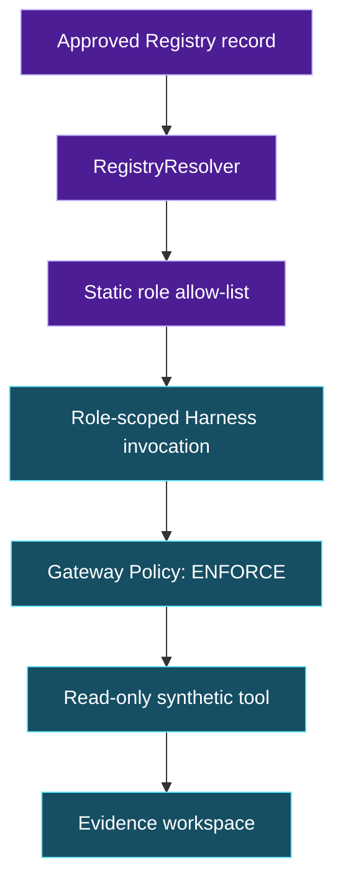

## 9. The read-only analysis boundary

OpsFusion deliberately stops after evidence reconciliation. The specialist
agents can inspect synthetic metrics, logs, changes, database pressure, queue
depth, orders, and customer impact, but they cannot plan or execute a
simulator change.

The boundary is enforced in three places:

- `agents/roles.py` defines only read-only role tool sets and prompts;
- `gateway/tool_catalog.py` registers only read-only tools;
- `apps/api/app.py` exposes investigation, follow-up, evidence, and evaluation
  reads, but no planning, approval, execution, recovery-tick, or verification
  mutation routes.

When the evidence workspace has enough findings, the durable checkpoint is
saved as `completed` with `analysis_complete: true` and `read_only_mode: true`.
The simulator remains in its original incident state. That is intentional:
this console explains what happened and what the evidence supports; it is not
a remediation control plane.

## 10. Durable execution and analysis completion

There are two different kinds of state to protect:

- **Harness state:** the managed model/tool interaction within one role
  invocation.
- **Workflow state:** investigation stage, task results, evidence references,
  follow-up requests, and the final analysis checkpoint.

OpsFusion stores workflow state in DynamoDB through
`DynamoCheckpointStore` and `EvidenceStore`. Each checkpoint carries a
version and uses optimistic concurrency checks.

The Step Functions definition in
[`infrastructure/cloudformation/stacks/05-workflow.yaml`](infrastructure/cloudformation/stacks/05-workflow.yaml)
provides durable stage boundaries:

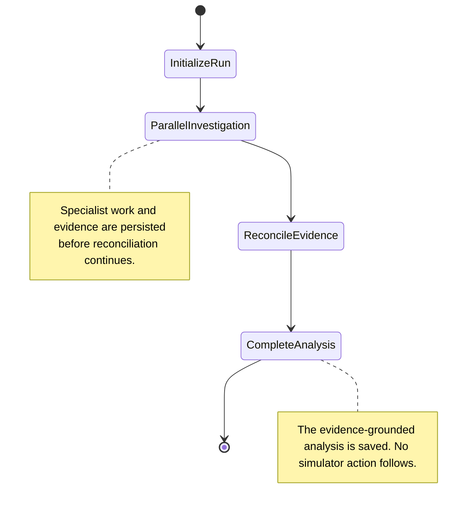

`workflow/worker.py` is intentionally thin. It validates a named stage,
hydrates the checkpoint, prevents an older replay from moving the workflow
backward, and returns checkpoint metadata to Step Functions. It does not
implement a second model/tool loop.

The local and API workflow can also inject an interruption after the
specialist checkpoint. On resume, completed findings remain in the evidence
workspace and the parallel branch is not unnecessarily repeated.

## 11. The console exposes execution evidence, not private reasoning

The console in `apps/web/src/` is a thin operator view over the API. The first
and only investigation workspace is a business-readable live trace. It shows
the three specialist lanes, the orchestrator reconciliation, the current
business question, the actual read-only tool call, and the evidence returned.
Hovering over a lane shows a compact prompt/reason/result summary. Selecting a
lane opens the persisted skill definition, prompt trace, tools, tool results,
and evidence references. Findings and evaluation checks are expandable below
the trace; raw Gateway audit payloads are kept out of the primary business
view.

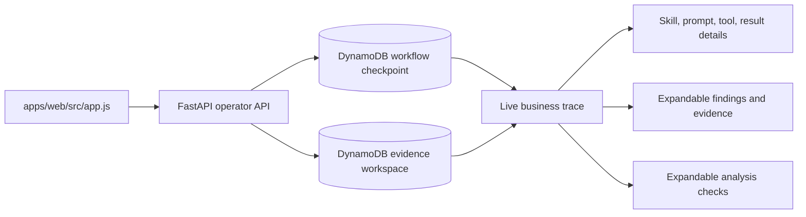

The API does not return hidden scenario truth or raw private model reasoning.
The Harness invocation contract records bounded event metadata, tool uses,
usage, stop reasons, findings, hypotheses, and evidence references.

## 12. Cognito access boundary

The deployed console follows the same application-level Cognito pattern as the
reference Agent Harness demo. The Lambda Function URL remains a transport
endpoint, so it can serve the login shell and public health check. FastAPI
validates the Cognito ID token against the User Pool issuer, audience, expiry,
`token_use`, and cached JWKS before protected routes enter the simulator or
workflow.

The User Pool is invite-only. The browser can display the invitation form only
for an administrator, but the API is authoritative: `/admin/users` requires a
verified `opsfusion-admin` group claim and the IAM role is separately limited
to `cognito-idp:AdminCreateUser`. Newly invited users are not administrators by
default. All investigation routes remain read-only for every authenticated
operator.

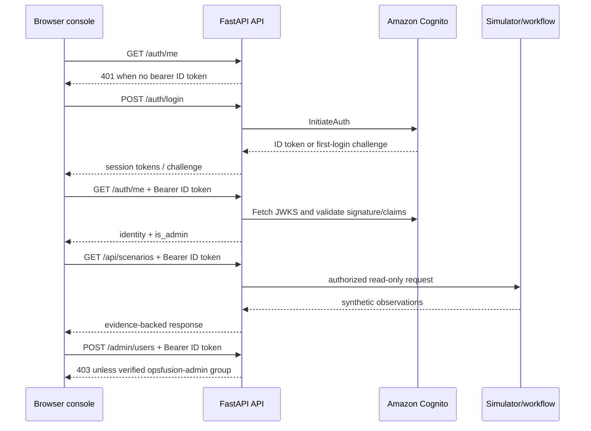

This is application-level authentication rather than a native Cognito
authorizer on the Function URL. The API boundary is still enforced for every
protected request, which keeps a public login shell separate from protected
operational data and analysis workflows.

## 13. Independent evaluation

OpsFusion evaluates the run outside the agent's reasoning loop.

The deterministic evaluator in
[`evaluation/deterministic.py`](evaluation/deterministic.py) can access hidden
truth through the evaluator-only `ScenarioEngine.hidden_truth()` method. It
checks:

- every evidence citation resolves inside the run workspace;
- hidden evaluator keys are absent from shared evidence;
- the hypothesis contains the expected causal terms for the scenario;
- the analysis checkpoint is complete;
- the simulator snapshot is unchanged from run creation.

The evaluator returns these checks directly. There is no report publication or
post-analysis action stage.

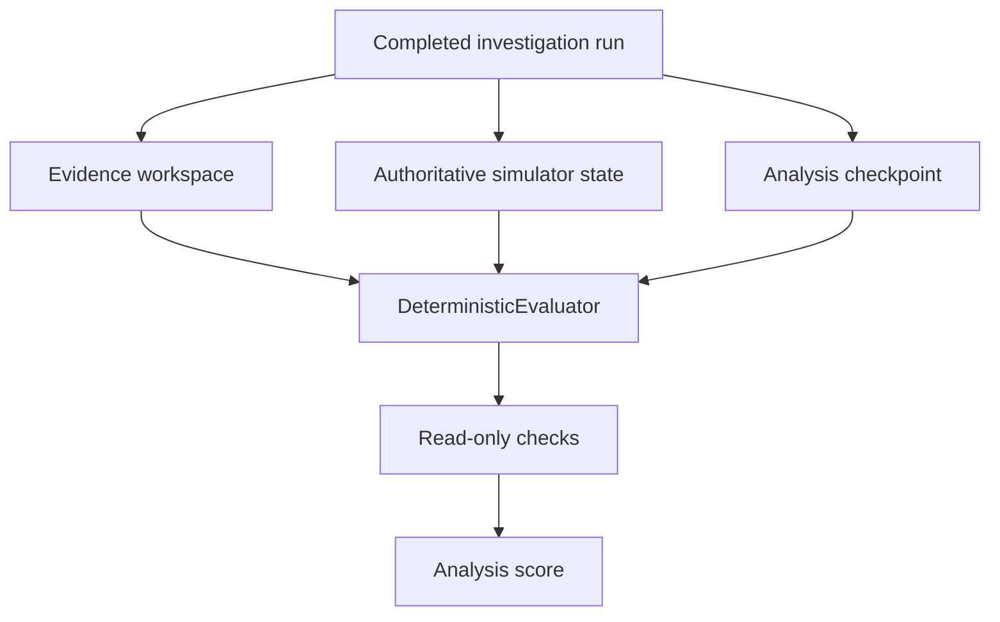

This keeps compliance and reasoning quality visible as separate dimensions.
The evaluator does not run another agent investigation and does not teach the
agent the hidden answer through a tool response.

## 13. Following `INC-2048` from start to finish

The complete path is:

1. Create a run for `INC-2048` with a deterministic seed.
2. The workflow creates an `initialize` checkpoint.
3. Telemetry, Change, and Data sessions run concurrently.
4. Each Harness invocation calls only its role's permitted Gateway tools.
5. Tool observations are materialized into the evidence workspace.
6. The Orchestrator Harness session reconciles findings and requests more
   evidence if necessary.
7. The Orchestrator reconciles the evidence and requests more evidence if a
   material gap remains.
8. Read-only follow-up checks run automatically and persist their observations.
9. The workflow saves `analysis_complete` and leaves simulator state unchanged.
10. The evaluator produces deterministic read-only analysis checks.

The following relationship shows why the stages are not interchangeable:


## 14. Concept boundaries at a glance

| Concept | Owns | Does not own |
| --- | --- | --- |
| AgentCore Harness | Model reasoning, tool selection, iteration, stopping | Simulator truth or state changes |
| AgentCore Gateway | Tool exposure and routing to the bounded target | Root-cause conclusions or operator authorization |
| Agent Registry | Capability metadata, versions, approval, discovery | Permission to change an incident run |
| AgentCore Policy | Gateway-side read-only policy enforcement | Simulator mutation |
| AgentCore Memory | Historical context for Harness | Current operational truth |
| InvestigationCoordinator | Concurrent specialist scheduling and result collection | The model's next tool choice inside Harness |
| Step Functions | Durable stage transitions and retries | The inner model/tool loop |
| EvidenceStore | Provenance, findings, hypotheses, questions, tool events | Hidden evaluator truth |
| ScenarioEngine | Synthetic authoritative state and observations | Choosing what the agent should conclude |
| Evaluator | Read-only compliance and causal comparison | Helping the agent during investigation |

This separation is what allows the system to demonstrate genuine model-driven
investigation while keeping consequential authority outside the model.

## 15. Exploring the implementation

Follow the code in the same order as an investigation:

| File | What to inspect |
| --- | --- |
| [`apps/api/app.py`](apps/api/app.py) | Read-only operator API, runtime assembly, and Harness-vs-stub selection |
| [`agents/roles.py`](agents/roles.py) | Role descriptions, skills, and least-privilege tool sets |
| [`agents/harness.py`](agents/harness.py) | `InvokeHarness` adapter, event normalization, limits, and Gateway binding |
| [`agents/session.py`](agents/session.py) | Registry resolution, prompt construction, evidence materialization, and output parsing |
| [`workflow/local.py`](workflow/local.py) | Concurrent specialist scheduling and finding persistence |
| [`workflow/durable.py`](workflow/durable.py) | Checkpoints, reconciliation, follow-up, and analysis completion |
| [`workflow/worker.py`](workflow/worker.py) | Step Functions checkpoint boundary and idempotent stage handling |
| [`gateway/tool_catalog.py`](gateway/tool_catalog.py) | Tool contracts, role authorization, evidence IDs, and simulator dispatch |
| [`gateway/lambda_handler.py`](gateway/lambda_handler.py) | AgentCore Gateway Lambda event adapter |
| [`simulator/engine.py`](simulator/engine.py) | Synthetic observations and the hidden truth boundary |
| [`evidence/store.py`](evidence/store.py) | Run-scoped evidence, finding, hypothesis, and tool-event workspace |
| [`registry/discovery.py`](registry/discovery.py) | Approved Registry resolution plus static role allow-list enforcement |
| [`infrastructure/cloudformation/stacks/04-agentcore.yaml`](infrastructure/cloudformation/stacks/04-agentcore.yaml) | CloudFormation-managed Gateway, target, Harness, Memory, and `ENFORCE` policy |
| [`evaluation/deterministic.py`](evaluation/deterministic.py) | Evaluator-only hidden truth checks and compliance score |
| [`apps/web/src/app.js`](apps/web/src/app.js) | Console views and operator actions |
| [`infrastructure/cloudformation/deployment.yaml`](infrastructure/cloudformation/deployment.yaml) | Stack dependency graph and deployment hooks |
| [`infrastructure/cloudformation/stacks/05-workflow.yaml`](infrastructure/cloudformation/stacks/05-workflow.yaml) | Durable Step Functions state machine |

For a quick local tour:

```bash
cd /path/to/multi-agent-demo
python3 -m pytest -q
(cd apps/web && npm test && npm run build)
```

For the deployed environment, follow
[`docs/DEPLOYMENT.md`](docs/DEPLOYMENT.md) and use the AWS profile configured
for your environment explicitly.

## Conclusion

OpsFusion demonstrates a multi-agent incident investigation without hiding the
agentic behavior inside application code.

Harness manages each role's model/tool loop. Gateway provides bounded
observations. The coordinator runs independent specialist work and persists
structured evidence. The orchestrator reconciles the evidence. Registry,
Policy, Memory, and Identity provide capability governance and runtime
boundaries. Step Functions and DynamoDB preserve workflow progress. The
application owns the read-only analysis boundary, and the evaluator scores the
result without changing simulator state.

The resulting system can be model-driven where it should be model-driven, and
deterministic where the demonstration needs safety, provenance, repeatability,
and evaluation.

## References

- [Amazon Bedrock AgentCore Harness](https://docs.aws.amazon.com/bedrock-agentcore/latest/devguide/harness.html)
- [Get started with AgentCore Harness](https://docs.aws.amazon.com/bedrock-agentcore/latest/devguide/harness-get-started.html)
- [Use tools with AgentCore Harness](https://docs.aws.amazon.com/bedrock-agentcore/latest/devguide/harness-tools.html)
- [Add a Lambda target to AgentCore Gateway](https://docs.aws.amazon.com/bedrock-agentcore/latest/devguide/gateway-add-target-lambda.html)
- [AgentCore Policy](https://docs.aws.amazon.com/bedrock-agentcore/latest/devguide/policy.html)
- [AgentCore Identity](https://docs.aws.amazon.com/bedrock-agentcore/latest/devguide/identity.html)
- [AgentCore Registry](https://docs.aws.amazon.com/bedrock-agentcore/latest/devguide/registry.html)
