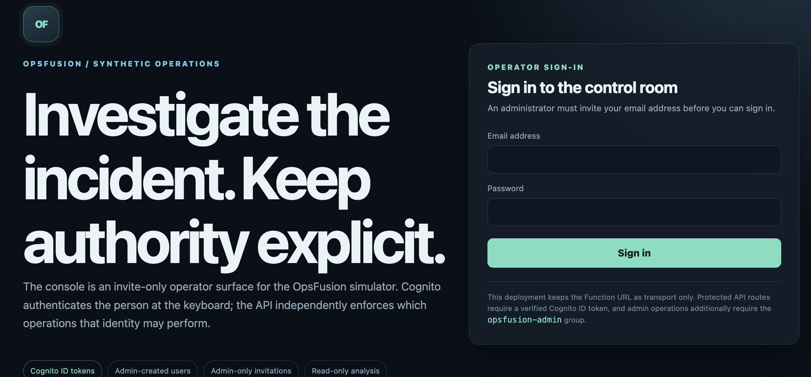
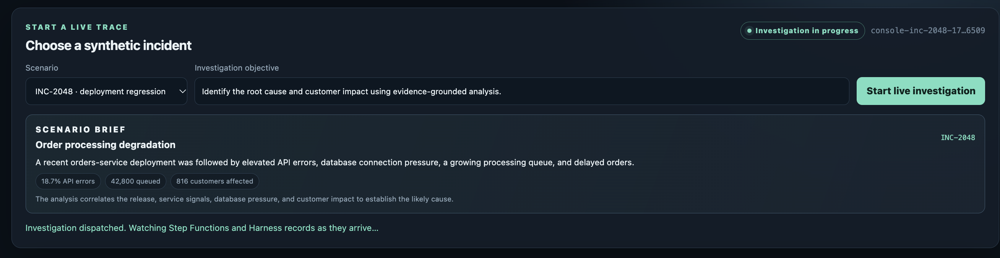
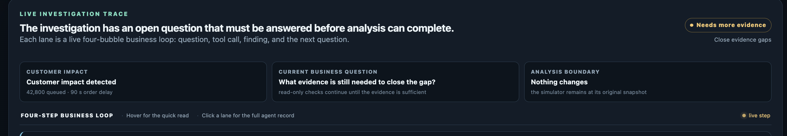
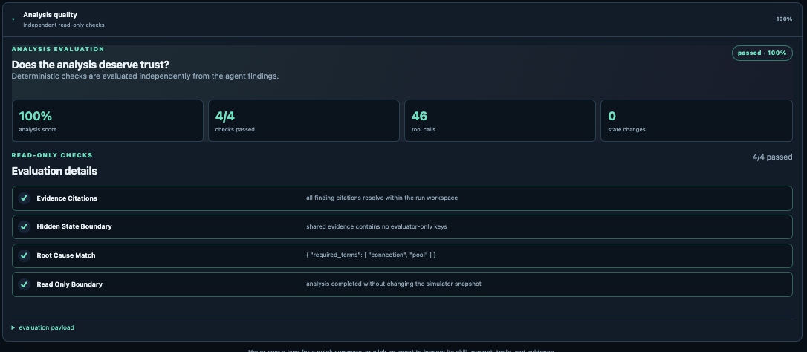

# OpsFusion web walkthrough

These screenshots show the operator path through the read-only web console.
The same walkthrough is included in the [README](README.md).

## 1. Operator sign-in

## 2. Synthetic incident selection

## 3. Live investigation trace

## 4. Analysis evaluation

The source screenshot set included three additional identical captures of the
live trace. They are retained in `images/` with `duplicate` in their filenames
for traceability, while the walkthrough uses the canonical capture above.
